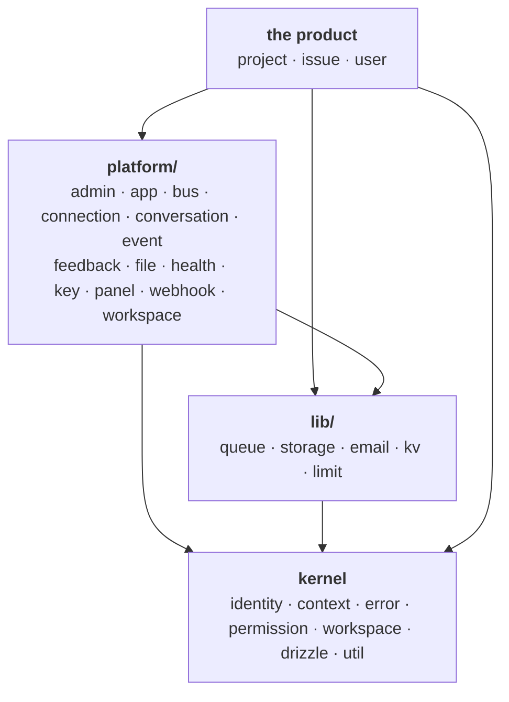

# Core

`packages/core` is a leaf: domain logic, schema, migrations. Four tiers, three of them
visible as directories.

Arrows are the only legal import direction. A cycle, or an arrow pointing up, is a bug.

| Tier        | What it is                                                                                |
| ----------- | ----------------------------------------------------------------------------------------- |
| kernel      | Cross-cutting primitives, no tables of their own. Everyone may reach them.                |
| `lib/`      | A capability behind a `port.ts` + `adapter/`, picked at boot from env.                    |
| `platform/` | Full features (tables, `Identity.check`, API surface) generic to any app on the template. |
| product     | What a fork rewrites.                                                                     |

## Where does a new module go?

**When you fork this template into a real product, does the module get rewritten?**

- Yes → top level, next to `issue/`.
- No, but it has a table and an identity check → `platform/`.
- Never touched, only reconfigured → `lib/`, behind a port.

## Import paths stay flat

Grouping is a disk concern, invisible to consumers: `@agents/core/key`, not
`@agents/core/platform/key` — same as `lib/queue` exporting as `@agents/core/queue`.
The `"./*"` wildcard in `package.json` only covers top-level directories, so **a grouped
module needs an explicit `exports` entry**. The Drizzle globs are `./src/**/*.central.ts`
and `./src/**/*.sql.ts`, so nesting never affects migrations.

## Workspaces

`*.central.ts` tables live in the `central` schema, shared by everyone (accounts, keys, auth,
queue, kv, the `platform/workspace` registry). `*.sql.ts` tables are unqualified tenant tables:
`Workspace.provide` sets the transaction's search_path to the workspace's `ws_*` schema.
Surfaces call `Auth.enter(slug, fn)` once, after auth: it enters the workspace through
`Workspaces.enter` and re-reads the caller there. Migrations split the same way:
`migrations/central` and `migrations/tenant`, each bundled to an `index.ts` by `db:generate`, so
`Migrations` runs in a Worker too.

Central modules read through `Central.use`/`transaction` (`drizzle/central`), tenant ones through
`Database`. Single and multi mode share one path: every workspace is a registry row with its
own schema. `WORKSPACES=single` (the default) is only a cap: `create` refuses a second one and
`enter` uses the one there is, with no pick. `Workspaces.create` writes a `pending` row and
queues `workspace.setup` (migrate, seat the owner, mark `ready`); `resolve` 409s until then.

Someone in no workspace lands on the dashboard's `/start`: create one (while `vacant`), or join
one from an invite. `Workspaces.invite` (needs `user:create`; only an owner offers `owner`)
writes a `central.invite` and mails it; the invitee sees it in `offers` and takes it with
`accept`, which seats them at its role, or turns it down with `decline`.

`WORKSPACE_SCHEMA` names an ambient schema read when no workspace is provided. It is for scripts
and tests only (the test preload sets `public`, where `db:push` lays every table); a deployed
app leaves it unset.

People are split the same way:

- `central.account` is the login, with an app-wide `role` of `user` or `superadmin`. A
  superadmin runs the platform and the deploy (the registry, the instance); that is
  `Identity.superadmin()` / `Identity.assert.superadmin(message)`, never a grant.
- Each workspace's `user` table holds its people and Apps. A person's row shares their account
  id; an App has no account, and its keys carry the schema it lives in. Its `role` (owner, admin,
  member) is `Identity.role`, so every permission is inside a workspace.
- Outside one (multi mode before a pick) an identity holds no role; the account's own things
  (keys, prefs, password) check `Identity.self(grants)` instead.
- `central.access` lists who can see a workspace, so listing one's workspaces never opens each.

Database per workspace, when an app needs it: add a `database` column to `WorkspaceTable`
naming an env binding; `Workspaces.connect.provide((row) => clients[row.database], fn)` in the
hooks/targets so `enter` and the setup job open that client; and `Central.provide(client, fn)`
there too, so central work keeps its own pool and transaction instead of the tenant's.

## Events

Slices declare and publish typed events through `platform/bus`. See [events.md](events.md).

## Known exceptions

- `lib/storage` reaches `platform/key` for `Signing.current`, inside `fromEnv` only — the
  port itself takes the key as an option, so nothing in the port layer knows about it.
- `lib/kv`'s redis adapter imports `"bun"`, so it stays out of `Kv.Providers` and the Worker
  bundle; Bun targets import it as `@agents/core/kv/adapter/redis`.
- `lib/limit` has a `port.ts` (the algorithm contract) but no `adapter/`: it counts in
  `lib/kv`, so its backend is whichever Kv the process provides.
- `platform/event` joins `user/user.sql` to name the actor on a log row. Platform may reach
  `user`, the identity anchor; nothing else in the product.
- `platform/admin` reads `project` and `issue` tables for its counts — the one arrow that
  points up. A fork rewrites the tallies in `counts`; the rest of the back office is generic.
- `platform/app` reaches `auth` to identify an App's account when it posts an event in.
- `platform/panel` has no table: each panel is one JSON file in `lib/storage` at
  `panels/<userID>/<id>.json`, metadata included. As with `platform/file`, the prefix is the
  owner, so a caller only lists and opens their own.

File-level conventions (module shape, ordering inside a file) live in
[`packages/core/AGENTS.md`](../packages/core/AGENTS.md).
